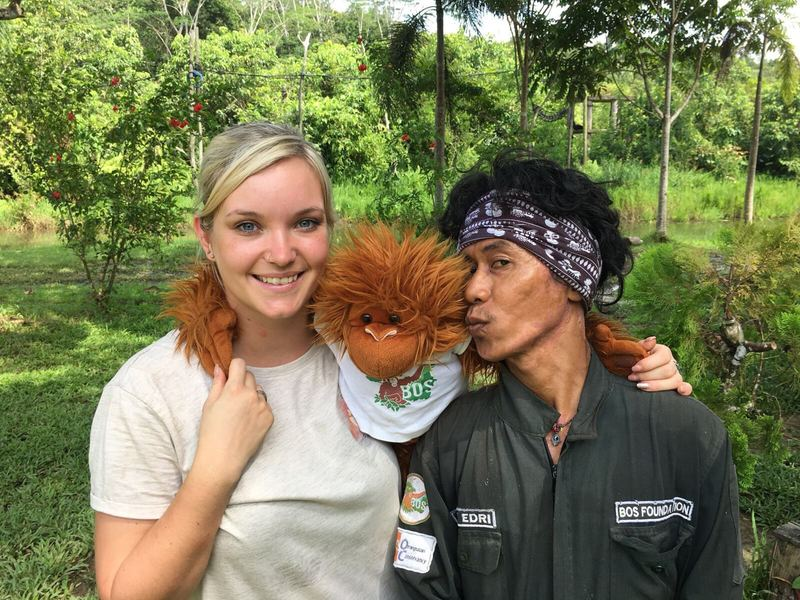

Seit mehreren Jahren unterstützt One Tree One Life als eigenständige Kampagne die Aufforstungs- und Waldschutzvorhaben von BOS Schweiz. **Ziel** der Kampagne ist es, möglichst viel **Geld für Aufforstungs- und Waldschutzprojekte** zu **sammeln**. Getragen und unterstützt wird die Kampagne von Volontärinnen, Volontären und Sponsoren. Die Volontärinnen und Volontäre helfen mit eigenen PR- und Fundraising-Aktivitäten. Zwei bis maximal 4 Wochen lang pflanzen sie zudem einen Teil der **Bäume selber, helfen** **in der BOS-Rettungsstation in Samboja Lestari mit und besuchen am Ende des Aufenthaltes in der Regel die zweite BOS-Rettungsstation in Nyaru Menteng**. Mehr dazu erfahren Sie unter [bos-schweiz.ch](https://www.bos-schweiz.ch/de/helfen/unterstuetzung/volontariat-bei-bos.htm). Auch in Zukunft sind ähnliche Volontärreisen geplant. Bei Interesse bitte an info(at)bos-schweiz.ch wenden.

{:figure .image.right}
{:class="img-responsive"}
_Quelle: BOS Schweiz_

Die One-Tree-One-Life-Kampagne und die begleitenden Volontärreisen wurden von **Angela Burri** ins Leben gerufen. Bereits 2016, nach der verheerenden Brandkatastrophe in Borneo, setzte sie sich für die Wiederaufforstung des Regenwaldes rund um die Rettungsstation Samboja Lestari ein. Damals pflanzte sie nicht nur die Setzlinge. Sie machte auch in ihrem Familien-, Freundes- und Bekanntenkreis mit ihrem Engagement auf die Orang-Utans und ihre Probleme aufmerksam und sammelte Spenden für die Aktion. 2018 brach sie mit Gleichgesinnten erneut nach Borneo auf und leitete die ersten beiden Volontärreisen.
