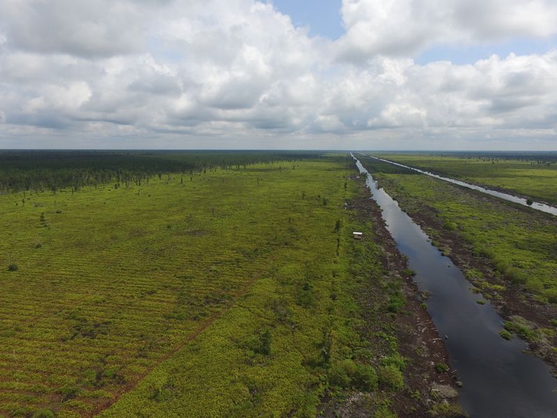

**Renaturierung und Aufforstung zerstörter Wälder**

Auch 300 Hektare Regenwald rund um die **BOS-Rettungsstation in Samboja Lestari** fielen 2015 den Flammen zum Opfer. Einen Teil dieses Gebietes forsten wir heute gemeinsam mit den Freiwilligen im Rahmen der One-Tree-One-Life-Kampagne wieder auf. Die Setzlinge werden in einer eigenen Baumschule gezogen. Gepflanzt wird ein Mix aus Frucht- und Nutzbäumen, alles endemische und meist bedrohte Arten. Knapp 220 Hektare liegen noch vor uns.

Dass das gemeinsam durchaus möglich ist, wissen wir aus Erfahrung: In mühevoller Kleinarbeit wurde nämlich einst das gesamte 1800 Hektare grosse Gebiet von Samboja Lestari Baum für Baum aufgeforstet. Am heutigen Standort der BOS-Rettungsstation befand sich vor knapp 20 Jahren lediglich eine durch Abholzung und Waldbrände völlig ausgezehrte, nährstoff- und artenarme Grassteppe.

{:figure .image.right}
{:class="img-responsive"}
_Quelle: Björn Vaughn, BPI_

Der Wald von Samboja Lestari beheimatet keine wilde Orang-Utan-Population. In Samboja Lestari werden aber traumatisierte, verletzte und verwaiste Orang-Utans rehabilitiert und auf ihre Auswilderung vorbereitet. Zudem sind viele der ursprünglichen Tierarten in den aufgeforsteten Regenwald zurückgekehrt.

Ebenfalls dringend erhalten werden muss ein **Torfmoorregenwald im Mawas-Gebiet** in Zentral-Kalimantan. Ende der 90iger Jahre initiierte der indonesische Diktator Suharto dort sein Mega Rice Project, wofür landesweit über 1 Mio. Hektare Torfmoorregenwald abgeholzt und alleine in Borneo rund 4000 Kilometer Entwässerungskanäle gegraben wurden. Das Projekt verfehlte sein Ziel, die Lebensmittelknappheit zu bekämpfen. Stattdessen wurde ein weltweit einzigartiges Ökosystem zerstört, das tausenden, teils stark bedrohten Arten ein Zuhause bot.

{:figure .image.left}
{:class="img-responsive"}
_Quelle: Björn Vaughn, BPI_

Im Laufe der letzten 20 Jahre haben die Kanäle die einst feuchten Torfmoorböden weitgehend ausgetrocknet und so den natürlichen Brandschutz zerstört. Heute ist der Mawas-Regenwald deshalb sehr anfällig für Brände. 

Mit diesem Problem sowie illegaler Abholzung sind wir in der Region rund um das Dorf Tuanan konfrontiert. Dort lebt in einem von BOS-verwalteten Schutzwald eine der letzten grossen wilden Orang-Utan-Populationen (knapp 2550 Tiere), die es zu schützen gilt. Im Rahmen des **Tuanan Projektes** verschliessen wir die ehemaligen Entwässerungskanäle und bilden Brandschutz-Teams aus. Der Torfmoorboden wird renaturiert und dann wieder aufgeforstet. In eigenen Baumschulen werden Setzlinge gezogen und von lokalen Kräften auch gepflanzt. Begleitende Mikrokreditprojekte schaffen alternative Einkommensquellen zur illegalen Abholzung und zur Wilderei.

Ebenfalls in Zentral-Kalimantan, im Sebangau Nationalpark, befindet sich der grösste nicht fragmentierte Tieflandregenwald Borneos. Dieser Wald - und insbesondere die Torfmoore rund um das Dorf **Sei-Bangah** – fungiert als riesiger Kohlenstoffspeicher und zeichnet sich durch einen unvergleichlichen Artenreichtum aus. Dort ist eine der grössten im Tiefland lebende Orang-Utan-Population beheimatet. Gemeinsam mit der Nationalpark-Behörde, der Dorfgemeinde und BOS Schweiz entwickelte unsere Partnerorganisation vor Ort - die Borneo Nature Foundation - Aktivitäten, um den Sei-Bangah-Wald vor Bränden zu schützen. Mehr zu unseren **aktuellen Aufforstungs- und Walschutzvorhaben** erfahren Sie [hier](https://www.bos-schweiz.ch/de/waldschutz/unsere-waldschutzprojekte.htm).

**Existierende Wälder schützen**

Nebst der Renaturierung und Aufforstung _zerstörter_ Waldgebiete, widmet sich BOS auch dem Erhalt von intakten Waldgebieten. Zum einen unterhält und verwaltet die BOS Foundation ein **eigenes Waldgebiet**, das sie für Auswilderungen nutzt. Der Wald von **Kehje Sewen** ist 86594 Hektare gross - und damit grösser als Singapur! Das fast unberührte Regenwaldgebiet in Ost-Kalimantan wird über Generationen von der BOS Foundation als sogenannte Ecosystem Restoration Concession verwaltet, d.h. für Naturschutzzwecke genutzt. Mehrere Camps zur Überwachung der dort ausgewilderten Tiere wurden hier aufgebaut. Durch diese Präsenz sorgt BOS für den Schutz der Orang-Utans und des Waldes. Eine Erweiterung des Auswilderungsgebietes ist geplant. Sie soll Kehje Sewen mit dem nördlich gelegenen Schutzwald über einen Korridor verbinden, der es den Orang-Utans erlaubt, dorthin abzuwandern.

Mehrere **Nationalparks in Zentral- und Ost-Kalimantan** werden ebenfalls von BOS für Auswilderungen genutzt. Die dort angesiedelten Orang-Utans werden vom Post-Release-Monitoring Team der BOS Foundation überwacht und somit auch ihr Lebensraum gegen Wilderei und Abholzung geschützt.

Im **Mawas-Gebiet in Zentral-Kalimantan** unterhält und verwaltet die BOS Foundation ein weiteres, 309000 Hektare grosses, Regenwaldgebiet. Der Wald beheimatet knapp 2550 wilde Orang-Utans. Ihn zu erhalten und zu schützten ist von enormer Bedeutung für den Artenschutz!

**Insgesamt stehen heute knapp 460680 Hektare, d.h. 4606 Quadratkilometer intakter und sehr wertvoller Regenwald unter dem Schutz der BOS Foundation!**